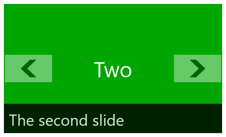
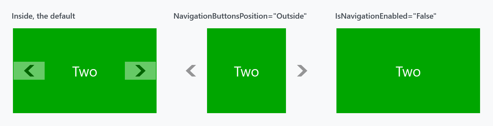
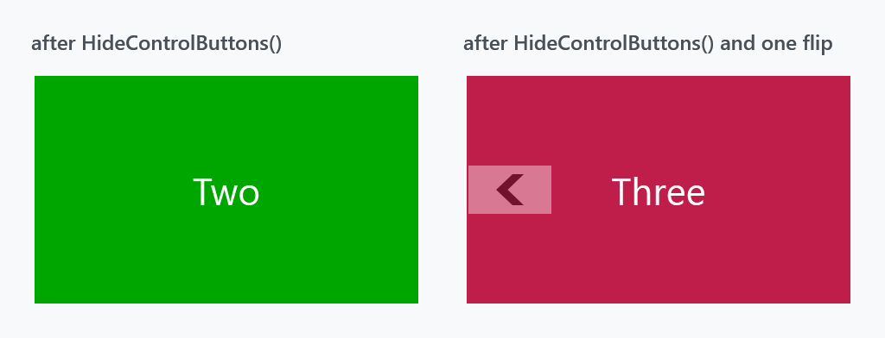
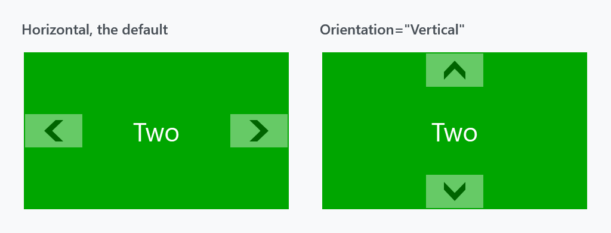
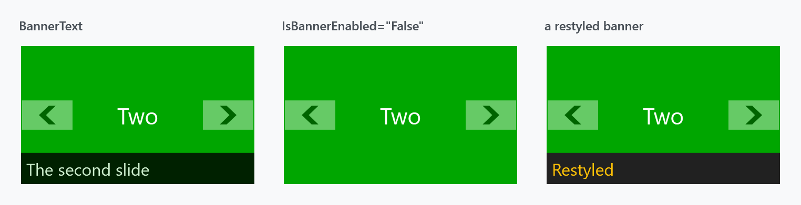
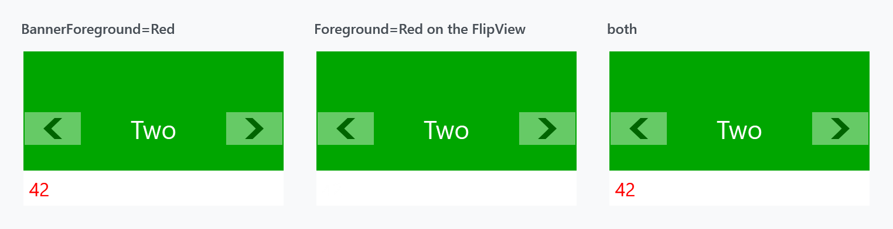
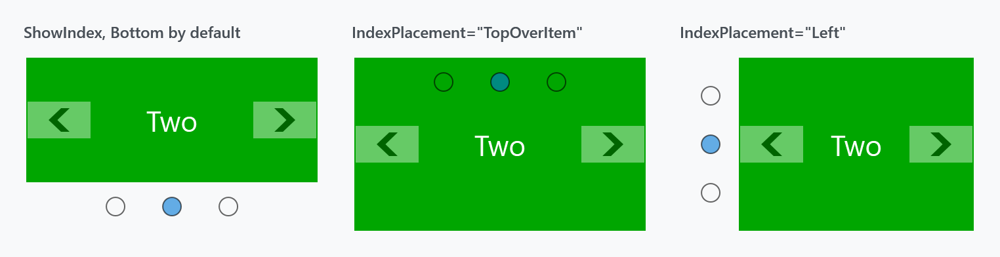

Title: FlipView
Description: A selector that shows one item at a time, with navigation and a banner
---

`FlipView` shows one item at a time and flips between them with animated transitions. It derives from `Selector`, so it is an items control with a selection — `ItemsSource`, `Items`, `SelectedItem` and `SelectedIndex` all work as usual.



```xml
<mah:FlipView Width="230" Height="140" BannerText="The second slide">
    <Grid Background="#FF2E8DEF" />
    <Grid Background="#FF00A600" />
    <Grid Background="#FFBF1E4B" />
</mah:FlipView>
```

It was inspired by the WinRT control of the same name but shares no code with it.

## Navigating

The user flips with the two buttons or with the arrow keys. In code:

| | |
| --- | --- |
| `GoBack()` / `GoForward()` | one item, honouring `CircularNavigation` |
| `SelectedIndex` | jump anywhere; the transition direction is worked out from the old and new index |
| `CircularNavigation` | `False` by default; when `True`, the ends wrap around |

Which button is visible is **computed, not fixed**. `DetectControlButtonsStatus` hides the back button on the first item and the forward button on the last, unless `CircularNavigation` is on.



| Property | Type | Default | |
| --- | --- | --- | --- |
| `IsNavigationEnabled` | `bool` | `True` | hides both buttons when `False` |
| `NavigationButtonsPosition` | `NavigationButtonsPosition` | `Inside` | `Inside` or `Outside` |
| `NavigationButtonStyle` | `Style` | `MahApps.Styles.Button.FlipView.Navigation` | |
| `ButtonBackContent` / `ButtonForwardContent` / `ButtonUpContent` / `ButtonDownContent` | `object` | chevrons | each with a matching `…Template` and `…StringFormat` |

`Outside` puts the buttons beside the item instead of over it, which costs width — compare the second panel above with the first.

:::{.alert .alert-info}
The keyboard is tied to the buttons: `OnKeyDown` only acts if the button for that direction is **visible and enabled**. So hiding the buttons — through `IsNavigationEnabled="False"` or `HideControlButtons()` — takes the arrow keys with it. `Left`/`Right` flip when horizontal, `Up`/`Down` when vertical.
:::

:::{.alert .alert-warning}
**`HideControlButtons()` does not stick.** It is a one-shot: it sets the buttons' visibility once and changes no state.

```csharp
public void HideControlButtons()
{
    this.ExecuteWhenLoaded(() => this.DetectControlButtonsStatus(Visibility.Hidden));
}
```

Anything that recomputes the buttons afterwards brings them back — a selection change among them, which is exactly what an automatic slideshow does:



Both panels called `HideControlButtons()`. The right one then flipped once, and the back button returned. (The forward button stays hidden because that panel is now on the last item.)

Use **`IsNavigationEnabled="False"`** instead. It is a dependency property, it is re-read on every recompute, and it survives.
:::

## Swiping

The item can also be dragged aside, with the mouse, a pen or a finger. Nothing moves until the pointer has gone the drag distance of the system along the `Orientation`, as with drag and drop, so a click or a tap still reaches the item. A move that goes across first is left alone, since that is somebody scrolling.

Let go past half the item, or with a quick flick the same way, and it flips. Anything less and the item springs back. At an end without `CircularNavigation` the item only gives a little and never flips. The old item leaves to the side it was dragged to and the next one comes in from the other.

A drag that starts on a button in the item, or on content that scrolls in the same direction itself, stays with that content.

| Property | Type | Default |
| --- | --- | --- |
| `IsSwipeEnabled` | `bool` | `True` |

`IsNavigationEnabled="False"` hides the buttons but leaves swiping on. Set `IsSwipeEnabled="False"` as well where only code should flip.

:::{.alert .alert-info}
New on `develop`, it is not in 2.4.11. A released `FlipView` has no swipe gesture, only the buttons and the arrow keys. This is [#2508](https://github.com/MahApps/MahApps.Metro/issues/2508).
:::

## Transitions

The animation between items is a `TransitioningContentControl`, and there is one `TransitionType` per direction:

| Property | Default |
| --- | --- |
| `LeftTransition` | `LeftReplace` |
| `RightTransition` | `RightReplace` |
| `UpTransition` | `Up` |
| `DownTransition` | `Down` |

`Orientation` decides which pair is used: `Horizontal` uses left/right, `Vertical` uses up/down, and it also moves the buttons.



## The banner

The strip along the bottom. It is on by default and slides open and shut.



| Property | Type | Default | |
| --- | --- | --- | --- |
| `IsBannerEnabled` | `bool` | `True` | |
| `BannerText` | `object` | `null` | plus `BannerTextTemplate`, `BannerTextTemplateSelector`, `BannerTextStringFormat` |
| `BannerBackground` | `Brush` | `MahApps.Brushes.ThemeForeground` | |
| `BannerForeground` | `Brush` | `MahApps.Brushes.ThemeBackground` | |
| `BannerOpacity` | `double` | `0.8` | applies to the whole strip, text included |

The banner does not follow the selection on its own. Bind it to the selected item:

```xml
<mah:FlipView ItemsSource="{Binding Slides}"
              BannerText="{Binding SelectedItem.Caption, RelativeSource={RelativeSource Self}}" />
```

:::{.alert .alert-info}
On `develop` an item can also name its own banner, by way of a `FlipViewItem` in the item template:

```xml
<mah:FlipView ItemsSource="{Binding Slides}">
    <mah:FlipView.ItemTemplate>
        <DataTemplate>
            <mah:FlipViewItem BannerText="{Binding Caption}">
                <Image Source="{Binding Image}" />
            </mah:FlipViewItem>
        </DataTemplate>
    </mah:FlipView.ItemTemplate>
</mah:FlipView>
```

That is the only place for it. A `FlipView` shows its selected item in a presenter and wraps nothing in a container of its own, so there are no `FlipViewItem` containers for an `ItemContainerStyle` to reach. In a released version the item never found the control it belongs to and the banner kept the text a `FlipViewItem` starts out with, which is [#4447](https://github.com/MahApps/MahApps.Metro/issues/4447).

An item that names no banner leaves the one on the control alone, so the two ways can be mixed.
:::

:::{.alert .alert-info}
**The banner's text colour is `BannerForeground`, not `Foreground`.** Setting `Foreground` on the `FlipView` does nothing to the banner — the template binds the banner label to `BannerForeground`, which wins:



The middle panel sets `Foreground="Red"` and shows nothing at all, because `BannerForeground` is still its default of `MahApps.Brushes.ThemeBackground` — white text on the white banner. The third sets `Foreground="Blue"` and `BannerForeground="Red"` and comes out red.

`Foreground` is not useless, though: the item container style binds each `FlipViewItem`'s foreground to its owner's, so `Foreground` reaches the **items**.
:::

Changing `BannerText` fades the label out, swaps the text and fades it back in, so the new text does not appear instantly.

## The index

A row of dots showing how many items there are and which one is current. It is **off by default**, and the old documentation never mentioned it.



```xml
<mah:FlipView ShowIndex="True" IndexPlacement="TopOverItem" ItemsSource="{Binding Slides}" />
```

| Property | Type | Default | |
| --- | --- | --- | --- |
| `ShowIndex` | `bool` | `False` | |
| `IndexPlacement` | `NavigationIndexPlacement` | `Bottom` | |
| `IndexHorizontalAlignment` / `IndexVerticalAlignment` | | `Center` | within the strip |
| `IndexItemContainerStyle` | `Style` | `MahApps.Styles.ListBoxItem.FlipView.Index` | the dots |

`NavigationIndexPlacement` has eight values: `Left`, `Right`, `Top`, `Bottom`, and a `…OverItem` variant of each. The plain values give the index a strip of its own and shrink the item; the `OverItem` ones lay it over the item, as in the middle panel above.

The index is a `ListBox` in the template and it is clickable, so it navigates as well as reports. It shows every page, so with more pages than fit the dots share the row.

:::{.alert .alert-info}
On `develop` a dot of the Metro index stays whole when the row is too short for all of them and reaches into the space beside it. In a released version the padding of the theme cut it to a sliver. The WinUI look shows a [PipsPager](pipspager) as its index instead, with at most five dots that slide along with the selection, and there `IndexItemContainerStyle` has no effect.
:::

## The hover border

A border drawn over the item while the mouse is inside, to show the control has focus for the arrow keys.

| Property | Type | Default |
| --- | --- | --- |
| `MouseHoverBorderEnabled` | `bool` | `True` |
| `MouseHoverBorderBrush` | `Brush` | theme |
| `MouseHoverBorderThickness` | `Thickness` | `4` |

## An automatic slideshow

Increment `SelectedIndex` on a timer, with `CircularNavigation` so it wraps and `IsNavigationEnabled="False"` so the buttons stay away. On `develop` add `IsSwipeEnabled="False"` too, or the slides can still be dragged:

```xml
<mah:FlipView x:Name="Slideshow"
              CircularNavigation="True"
              IsNavigationEnabled="False"
              ShowIndex="True"
              ItemsSource="{Binding Slides}" />
```

```csharp
var timer = new DispatcherTimer { Interval = TimeSpan.FromSeconds(4) };
timer.Tick += (_, _) => this.Slideshow.GoForward();
timer.Start();
```

`GoForward()` wraps by itself once `CircularNavigation` is on, so there is no index arithmetic to get wrong.

## The three looks

| Set | Style | Look |
|---|---|---|
| Metro, `Themes/Generic.xaml` | `MahApps.Styles.FlipView` | the half transparent buttons, the hover border and the dots in the accent |
| Windows 10, `Styles/Win10/Controls.xaml` | `MahApps.Styles.FlipView.Win10` | the square buttons of UWP, 20 by 36, with the chevrons of the symbol font |
| WinUI, `Styles/WinUI/Controls.xaml` | `MahApps.Styles.FlipView.WinUI` | narrow buttons of 16 by 38 on the acrylic colour, rounded corners that also clip the item, and a [PipsPager](pipspager) as the index |

In both of the newer looks the buttons only show while the pointer is over the flip view, as in WinUI, and they are no tab stops; the arrow keys still flip. There is no hover border, and the index of the Windows 10 look draws the dots of the PipsPager.

:::{.alert .alert-info}
**The Windows 10 and the WinUI look are new on `develop`.** They are not in 2.4.11. Changing the template of a flip view at run time, by a set or by its `Style`, also needs `develop`: in 2.4.11 the banner animation throws when the template changes.
:::

## What a client is told

A flip view builds nothing for the pages it is not showing, so there is no list of pages to walk. It says which page is up and how many there are, as `1 / 3`, and the page itself with its banner is in the tree the way any content is.

:::{.alert .alert-info}
New on `develop`. In a released version it arrives as an empty list. This is [#4454](https://github.com/MahApps/MahApps.Metro/issues/4454).
:::

## Related

`FlipViewItem` is the container, styled by `MahApps.Styles.FlipViewItem`. The transitions come from [TransitioningContentControl](transitioningcontentcontrol). A [PipsPager](pipspager) is the index of the WinUI look and can stand next to any flip view.
